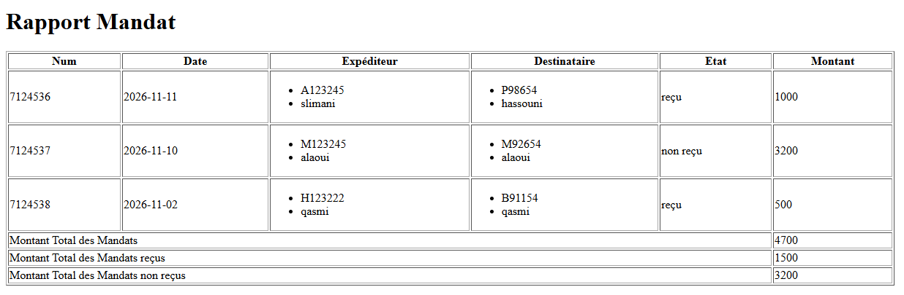

\# Rapport Mandat


\## 1 - L'arbre XML


```

rapport

└── mandat

&#x20;   ├── expediteur

&#x20;   │   ├── cin

&#x20;   │   ├── nom

&#x20;   │   ├── prenom

&#x20;   │   └── ville

&#x20;   ├── destinataire

&#x20;   │   ├── cin

&#x20;   │   ├── nom

&#x20;   │   ├── prenom

&#x20;   │   └── ville

&#x20;   ├── num

&#x20;   ├── date

&#x20;   ├── montant

&#x20;   └── etat

```


\## 2 - Capture d'écran du HTML




