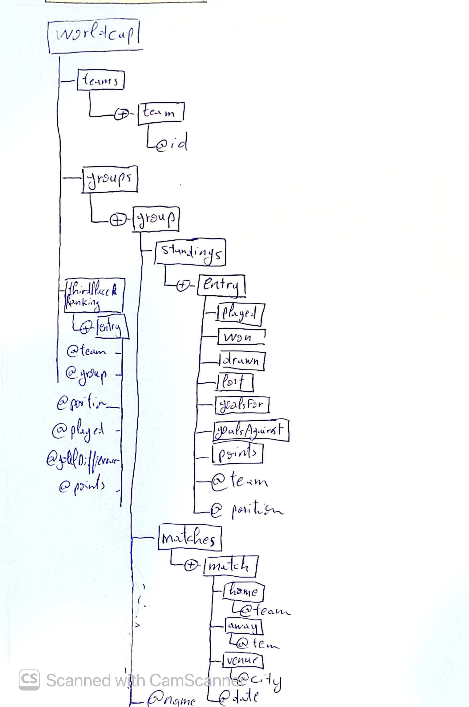

# World Cup 2026 Groups
C'est une base de données hiérarchique des résultats de la phase de groupes de la Coupe du monde 2026.
Les données sont extraites de Wikipédia et écrites sous forme XML avec un script Python.
J'ai défini le schéma XML (XSD) pour valider le document.
Voici l'arbre XML :

